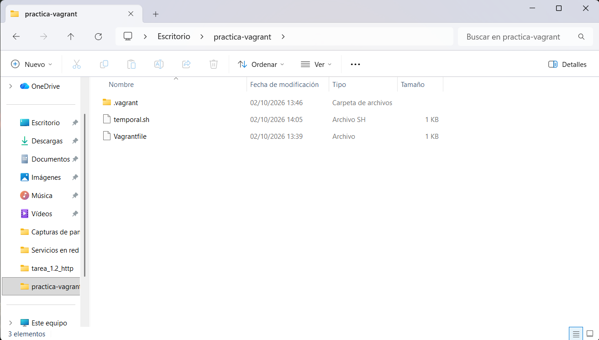
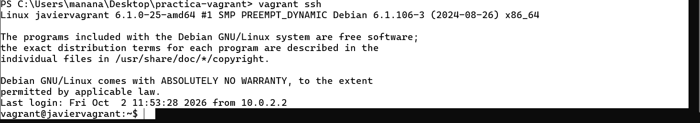
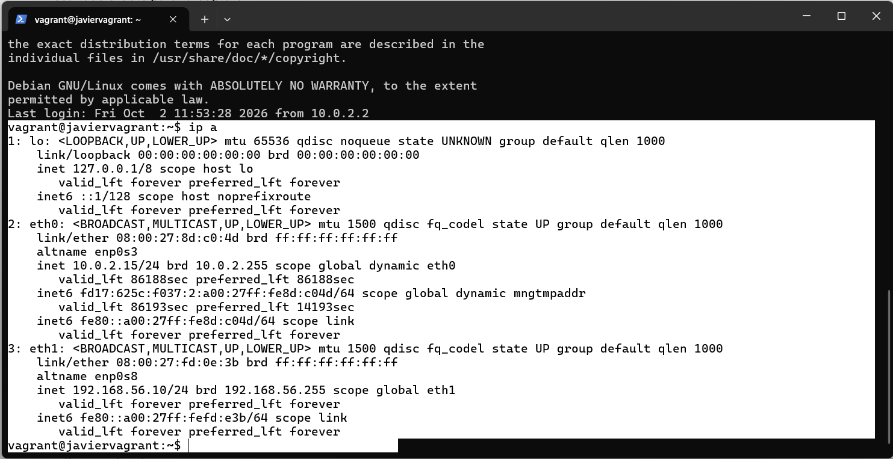
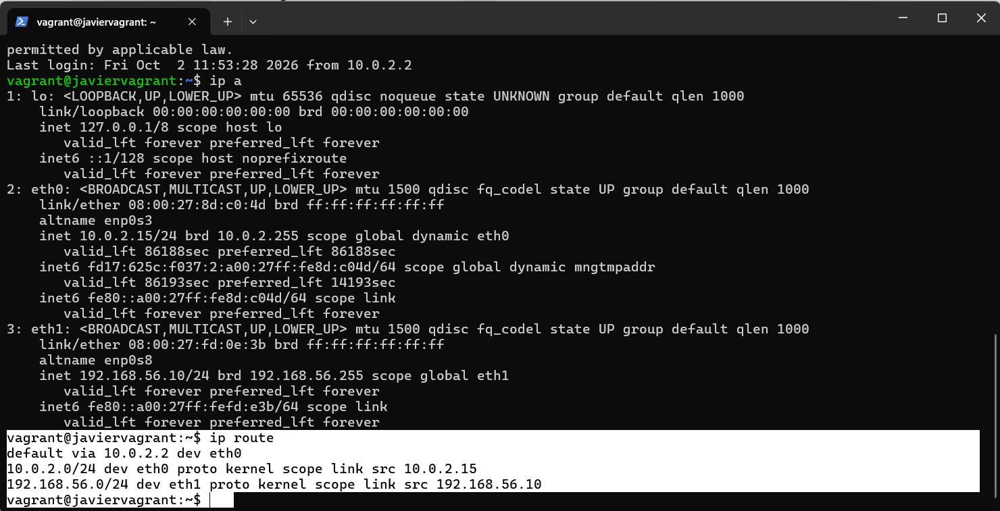
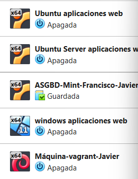
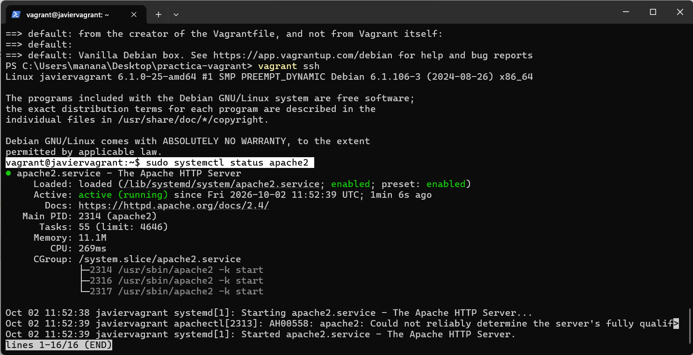
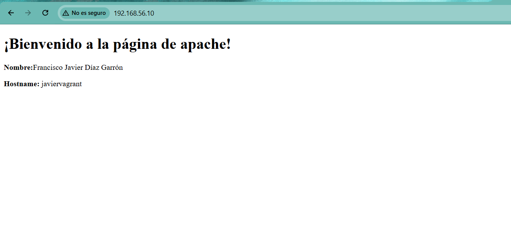
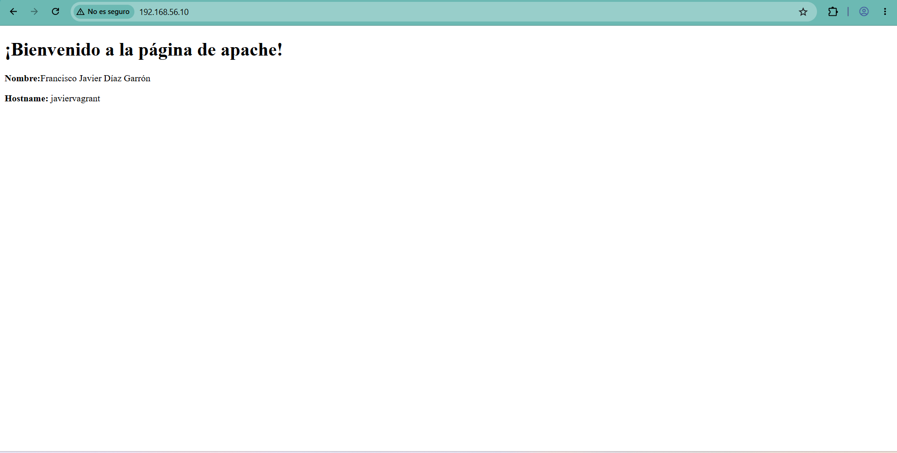

# Tarea-1.1.2  

## Parte A. Investiga antes de modificar el entorno  

### 1. Vagrant y el Vagrantfile. Explica brevemente qué problema resuelve Vagrant y distingue el anfitrión, el proveedor de virtualización, la box y la máquina virtual. Averigua en qué lenguaje está escrito el `Vagrantfile`. Analiza el archivo inicial y, al terminar la práctica, comenta cada línea activa del archivo final: qué configura, por qué la añadiste y cómo compruebas que ha surtido efecto.  

El problema que soluciona vagrant, es que al automatizar todo el proceso de creación y configuración de una máquina virtual te asegura que no vas a tener ningun fallo y tambien que todo el mundo que ejecute el archivo de vagrant va a tener la misma configuración de máquina virtual, por lo que resuelve ese problema de que cambies algo sin querer y ya por eso haya máquinas virtuales completamente distintas, por lo que lo que resuelve es sobre todo que no haya fallos en la creación y configuración.  

El anfitrión es el propio ordenador que utilizas y donde tienes todo, el proveedor de virtualización va a ser el encargado de realizar toda la creación y configuración de la máquina, ya que no lo hace vagrant en si si no que manda a otra aplicación a hacerlo, en mi caso virtualBox, la box es la imagen base del sistema operativo que tendrá la máquina virtual, es decir, como la plantilla del sistema operativo de la que se parte, y la máquina virtual es el resultado final, es decir, es lo que crea vagrant, una máquina con la que puedes trabajar sin que afecte a tu sistema principal.  

El lenguaje de programación que utiliza vagrantfile es Ruby.  

### 2. Aprovisionamiento. Investiga qué es un provisioner, dónde se ejecuta el script, cuándo lo lanza Vagrant y qué diferencia hay entre `inline:` y `path:`. Explica qué ocurre si modificas el script después del primer `vagrant up` y cómo lo ejecutarías de nuevo.  

Un provisioner es la herramienta que utiliza vagrant para instalar y configurar software en la máquina virtual sin tener que hacerlo tu, es decir que te automatiza mucho trabajo y te quita la posibilidad de tener algún error instalando o configurando algún software. El script que he realizado para descargar apache2 se ejecuta en la misma máquina virtual de Debian es decir dentro de ella, ya que prácticamente se encarga de configurar el sistema operativo de la máquina virtual.  

Vagrant lo lanza la primera vez que haces vagrant up, es decir la primera vez que creas la máquina, las siguientes veces que ejecutas vagrant up para encender la máquina vagrant lo ignora y ya no lo ejecuta, ya que esta instalada.  

La principal diferencia entre inline y path, es que inline se usa en el propio archivo de vagrantfile para ejecutar comandos cortos, mientras que path estas llamando a un archivo externo como por ejemplo el de instalar apache2 desde el archivo de vagrantfile para que se ejecute, lo cual mantiene el archivo más limpio que tener todos los comandos en el mismo archivo.  

Si modificas el archivo de descarga de apache2, no pasara absolutamente nada en la máquina virtual, ya que como se ha dicho una vez que se hace el primer vagrant up para crear la máquina virtual el archivo lo ignora completamente, por lo que lo que se debe hacer para que lo utilice la máquina es ejecutar vagrant provision si esta encendida la máquina, o si esta apagada hacer vagrant up --provision.  

### 3. Interfaces y redes Investiga qué conexión de red configura Vagrant por defecto y para qué la utiliza. Averigua cómo se añade en el Vagrantfile una segunda interfaz con dirección IP fija. Compara NAT, red interna, red privada host-only y red pública: explica con quién puede comunicarse la máquina en cada caso y qué función cumple el reenvío de puertos.  
### Presta especial atención a la diferencia entre la red interna de VirtualBox y la red privada host-only de VMware. Investiga cómo se configura la segunda interfaz en el proveedor que utilices. ¿Añadirla elimina la NAT predeterminada? ¿El reenvío de puertos crea una interfaz nueva?  
### En la parte C configurarás una máquina con dos interfaces: NAT y red de laboratorio. Examina después sus direcciones y rutas de red, relaciona lo observado con el Vagrantfile e incluye un esquema de la arquitectura en tu README.md. Como solo hay una máquina, no se pide demostrar comunicación con otra VM.  

### 4. Órdenes y carpeta compartida. En una tabla breve, indica cuándo usarías `up`, `status`, `ssh`, `reload`, `provision`, `halt` y `destroy`; marca cuáles llegaste a ejecutar. Averigua qué es `/vagrant` y comprueba qué archivos aparecen allí.  

| Comando | Cuándo usarlo | Lo he usado en la práctica |
| :--- | :--- | :---: |
| **up** | Para crear y también encender la máquina virtual cuando este apagada | **Sí** |
| **status** | Para saber el estado actual de la máquina virtual, si esta encendida, apagada, funcionando, con un error, etc .. | **Sí** |
| **ssh** | Para conectarse desde el anfitrión (en la terminal) a la máquina virtual de forma segura | **Sí** |
| **reload** | Para reiniciar la máquina virtual, es necesario usarlo si se hacen cambios en los archivos de vagrant de la máquina | **No** |
| **provision** | Para forzar a que se ejecute el script de aprovisionamiento, el que instala apache | **Sí** |
| **halt** | Para apagar la máquina virtual de manera segura, deteniendo todos los procesos del sistema operativo | **Sí** |
| **destroy** | Para borrar por completo la máquina virtual así como sus archivos y sus discos duros | **No** |  

/vagrant es una carpeta compartida que crea vagrant de manera automática, la cual contiene el mismo contenido que la carpeta donde están los archivos de vagrant y donde ejecute vagrant ssh, es decir que es prácticamente la misma carpeta que la carpeta vagrant del anfitrión.  

Prácticamente apareceria esto en la carpeta /vagrant.  
  

## Parte B. Mi primera máquina en Vagrant  
Trabaja desde el directorio del `Vagrantfile`. Comprueba que el archivo es válido y arranca la máquina con el proveedor que tengas instalado: VirtualBox (Recomendada) o VMware Workstation Pro. **Entra por SSH. Comprueba el nombre de la máquina, la versión de Debian, las interfaces y las rutas de red.**  

En esta captura se puede ver que he usado el comando vagrant ssh para conectarme por ssh a la máquina virtual que he creado, y como se puede observar no hay ningun fallo y aparte cambia la ruta en terminal de la ruta de la carpeta de vagrant, a vagrant@javiervagrant el cual es el hostname que le puse a la máquina, por lo que funciona sin problemas, y tambien en la captura se puede observar que indica que versión de Debian esta instalada en este caso Debian 12 6.1.0-25-amd64.  
  

En esta captura se puede ver las interfaces de red con el comando ip a que tiene la máquina de vagrant que he creado, que como se puede ver hay tres, lo la cual es la interfaz local de la propia máquina, eth0 la cual es la interfaz de la red NAT, por eso su IP es la 10.0.2.15/24 ya que es una IP pública y la que va a necesitar Debian para poder comunicarse con internet, y la eth1 la cual es la red privada que se creo con la Ip 192.168.56.10/24.  
  

En esta captura se puede ver que uso el comando ip route para ver las rutas de red que tiene la máquina de vagrant, como se puede ver en la linea default via 10.0.2.2 dev eth0 se define la puerta de enlace por defecto de la máquina la cual va a ser la interfaz NAT, por lo que todo el tráfico hacia el exterior pasara por ella, y en la linea 192.168.56.0/24 dev eth1, que todo el trafico de la red de laboratorio pase3 por la segunda interfaz que se añadió.(todas estas capturas se tomarón cuando ya se modifico el archivo de vagrant, por así decirlo sería el apartado B y C juntos).  
  

En esta captura se puede ver la máquina virtual en virtualbox cuando ya he acabado la práctica y esta apagada, la última la del nombre Máquina-vagrant-Javier.  
  

## Parte C. Completa el Vagrantfile  
Modifica el archivo inicial para crear **una máquina Debian 12 con dos interfaces o adaptadores de red**:  

Aqui esta el archivo con todas las lineas que pide el ejercicio.  
[Vagrantfile](archivos/Vagrantfile)

- Asigna un **hostname** identificable con tu nombre.

    config.vm.hostname = "javiervagrant", es esta linea en el archivo vagrantfile, y en las capturas se puede ver que aparece configurado.  

- Conserva la **NAT que Vagrant configura por defecto** como primera interfaz. Identifica qué dirección y
ruta recibe dentro de Debian.

- Añade una segunda interfaz con **IP fija en una red de laboratorio**. En VirtualBox configúrala como **red
interna**; en VMware Workstation Pro utiliza una red privada de tipo **host-only** y explica en `README.md`
la diferencia entre ambas modalidades. Puedes usar `192.168.56.10` como referencia si no entra en
conflicto con otra red del equipo.

Como se puede ver en la captura, esta ya el hostname, la primera interfaz eth0 es la NAT, la que configura vagrant por defecto, y la segunda la eth1 es la privada con la IP que dice el ejercicio que podemos usar la 192.168.56.10, se puede ver que en la interfaz NAT le ponen la dirección 10.0.2.15/24 y la ruta de red que le han puesto es la puerta de enlace predeterminada 10.0.2.2 para salir a internet.  

La diferencia entre red interna y host-only es que, con una red interna en VirtualBox, se configura una red que permite a las máquinas verse entre ellas pero ni las máquinas pueden comunicarse con nuestro ordenador ni nuestro ordenador puede comunicarse con ellas, mientras que con host-only en VMWare lo que hace es crear una tarjeta de red propia en nuestro ordenador para que se pueda comunicar con las máquinas virtuales.  
  
  

- Reenvía el puerto **80 de la máquina virtual al 8080 del anfitrión**, únicamente por `127.0.0.1`. Si el 8080
está ocupado, elige otro y justifícalo.

  config.vm.network "forwarded_port", guest: 80, host: 8080, host_ip: "127.0.0.1", esta linea del archivo hace lo que indica la práctica, reenviar el trafico del puerto 80 al 8080.  

- Vincular un script Bash de aprovisionamiento guardado en el repositorio  

- config.vm.provision "shell", path: "temporal.sh", esta es la linea que vincula el archivo provisiones que descarga y configura apache2 con el archivo vagrantfile.  

## Parte D. Aprovisiona Apache  
Crea un script Bash que instale Apache en Debian 12, active el servicio y escriba una página de inicio
sencilla. Esa página debe mostrar tu nombre y el hostname de la máquina. Investiga cómo volver a
ejecutar solo el aprovisionamiento después de modificarlo. Ejecútalo de nuevo y comprueba que el
servidor continúa funcionando.  

[Archivo para descargar apache2](archivos/temporal.sh)  

Con esta captura se puede observar que con un status, se nos muestra que el estado del servicio apache esta bien funcionando y sin problemas y encendido.  
  

Y con esta captura podemos ver que si en el buscador ponemos la dirección IP de la máquina virtual, la de la red privada, nos aparecera la página que hemos creado en el archivo de provisioner que vinculamos en el vagrantfile.  
  

Si hemos modificado el archivo y queremos volver a ejecutar el aprovisionamiento, al ya habre creado la máquina virtual tendremos que, o si esta encendida hacer vagrant provision, o si esta apagada vagrant up --provision, ya que una vez que se ejecuta vagrant up, el aprovisionamiento pasa a ser ignorado en los siguientes vagrant up.  

Comprobación de que sigue funcionando el servicio de apache despues de hacer el aprovisionamiento, esta vez poniendo el host en la página con la variable del sistema $(hostname)  
  
